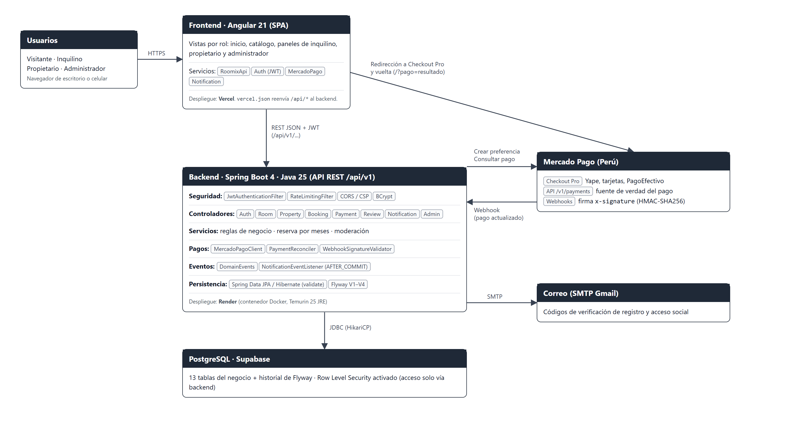

# Arquitectura

RoomiGo (Roomix Abancay) es una aplicación web de tres capas: una **SPA en Angular** consume una **API REST en
Spring Boot**, que persiste en **PostgreSQL** y se integra con **Mercado Pago** y un servidor de correo.

## Stack tecnológico

| Capa | Tecnología | Versión |
|---|---|---|
| Lenguaje backend | Java (Eclipse Temurin) | 25 |
| Framework backend | Spring Boot (Web MVC, Security, Data JPA, Validation, Mail) | 4.0.6 |
| Núcleo | Spring Framework / Spring Security | 7.0.7 / 7.0.5 |
| ORM | Hibernate ORM | 7.2.12 |
| Migraciones | Flyway (+ módulo PostgreSQL) | 11.14.1 |
| Base de datos | PostgreSQL (Supabase en producción, 17 en Docker local) | 17 |
| Pool de conexiones | HikariCP | 7.0.2 |
| JSON | Jackson | 3.1.2 |
| Autenticación | JWT con jjwt | 0.12.6 |
| Documentación de API | springdoc-openapi (Swagger UI) | 3.0.3 |
| Pruebas | JUnit 5, Spring Boot Test, MockMvc, Mockito, H2 | H2 2.4.240 |
| Frontend | Angular (componentes standalone + signals) | 21.2 |
| Lenguaje frontend | TypeScript / RxJS | 5.9 / 7.8 |
| Pasarela de pagos | Mercado Pago Checkout Pro (API REST) | — |
| Despliegue | Vercel (frontend), Render con Docker (backend), Supabase (BD) | — |

## Backend

Arquitectura por capas en `api/src/main/java/com/roomix/api`:

| Paquete | Responsabilidad | Archivos |
|---|---|---|
| `controller` | Endpoints REST (`/api/v1/...`), validación de entrada y respuesta estándar `ApiResponseDto` | 9 |
| `service` / `service/impl` | Reglas de negocio: reservas por meses, moderación, pagos, notificaciones | 15 |
| `repository` | Spring Data JPA y especificaciones de búsqueda | 11 |
| `entity` / `entity/enums` | Entidades JPA y enums del dominio | 23 |
| `dto` | Objetos de petición y respuesta | 22 |
| `mapper` | Conversión entidad ↔ DTO | 5 |
| `payment` | Integración con Mercado Pago: cliente HTTP, conciliador, validador de firma | 6 |
| `event` | Eventos de dominio y listener de notificaciones | 2 |
| `security` | JWT, filtro de autenticación, rate limiting, anti fuerza bruta, saneamiento | 7 |
| `config` | Seguridad, CORS, OpenAPI, datos iniciales | 5 |
| `exception` | Excepciones del dominio y manejador global | 7 |

Flujo de una petición: `JwtAuthenticationFilter` → `RateLimitingFilter` → controlador → servicio → repositorio →
PostgreSQL. Los errores se traducen a JSON en `GlobalExceptionHandler`.

### Decisiones de diseño

- **Esquema versionado con Flyway** (`db/migration`, V1–V4); Hibernate solo valida. En una base existente sin
  historial (Supabase), Flyway registra V1 como *baseline* sin ejecutarla.
- **Eventos de dominio + `@TransactionalEventListener(AFTER_COMMIT)`** para las notificaciones: nunca se notifica
  algo que no se guardó y un fallo al notificar no revierte la operación principal.
- **Conciliación única de pagos** (`PaymentReconciler`): el webhook y la vuelta del comprador aplican el pago por
  la misma lógica, con bloqueo pesimista, validación de monto/moneda e idempotencia.
- **Cliente HTTP propio** (`RestClient`) para Mercado Pago en lugar del SDK: solo se usan dos operaciones y es más
  fácil de probar con mocks.
- **Zona horaria America/Lima** en la JVM de producción para fechas coherentes en pagos y notificaciones.

## Frontend

SPA Angular 21 en `frontend/src/app` con 42 componentes standalone. El estado global vive en el componente `App`
(señales de Angular); los servicios de `core/` encapsulan la comunicación con la API:

| Servicio | Función |
|---|---|
| `RoomixApiService` | Habitaciones, propiedades, reservas, reseñas y administración |
| `AuthService` | Registro, inicio de sesión, JWT en `localStorage` y rol actual |
| `MercadoPagoService` | Crear checkout, redirigir a Mercado Pago y confirmar la vuelta |
| `NotificationService` | Campana: contador (cada 45 s, solo con la pestaña visible) y lista |
| `booking-dates.ts` | Suma de meses con el mismo criterio que `LocalDate.plusMonths` |

La URL de la API se resuelve en `api-config.ts`: `http://localhost:8081/api/v1` en local y `/api/v1` en cualquier
otro dominio (Vercel reenvía `/api/*` a Render; en desarrollo con túnel, `proxy.conf.mjs` reenvía al backend).

## Seguridad

- Contraseñas con **BCrypt**; sesión **sin estado** con JWT (24 h).
- Autorización por rol (`@PreAuthorize` y reglas en `SecurityConfig`) y comprobación de propiedad en los servicios.
- Cabeceras: CSP, `X-Frame-Options: DENY`, `nosniff`, `Referrer-Policy`, `Permissions-Policy`.
- **Rate limiting** por IP y bloqueo por intentos fallidos de login.
- Mercado Pago: el backend nunca recibe datos de tarjeta; webhook con firma HMAC-SHA256; cada pago se verifica
  contra la API de Mercado Pago.
- Secretos solo por variables de entorno (`api/.env` en local, ignorado por git).
- Supabase con Row Level Security y sin acceso directo por PostgREST.

Pendientes conocidos (ver `AUDIT-REPORT.md`): recuperación de contraseña en el backend, CORS por entorno y CSP más
estricta.

## Despliegue

| Componente | Plataforma | Notas |
|---|---|---|
| Frontend | Vercel | `vercel.json` reescribe `/api/*` hacia Render (sin CORS en el navegador) |
| Backend | Render (Docker) | `Dockerfile` multi-etapa: `maven:3.9-eclipse-temurin-25` → `eclipse-temurin:25-jre-jammy`; health check en `/health` |
| Base de datos | Supabase (PostgreSQL) | Connection pooler IPv4; RLS activado |
| Pagos | Mercado Pago Perú | Credenciales y URLs públicas por variables de entorno |
