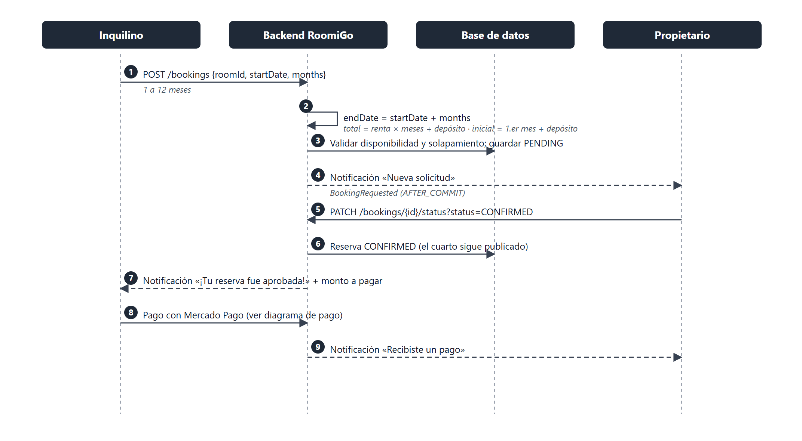
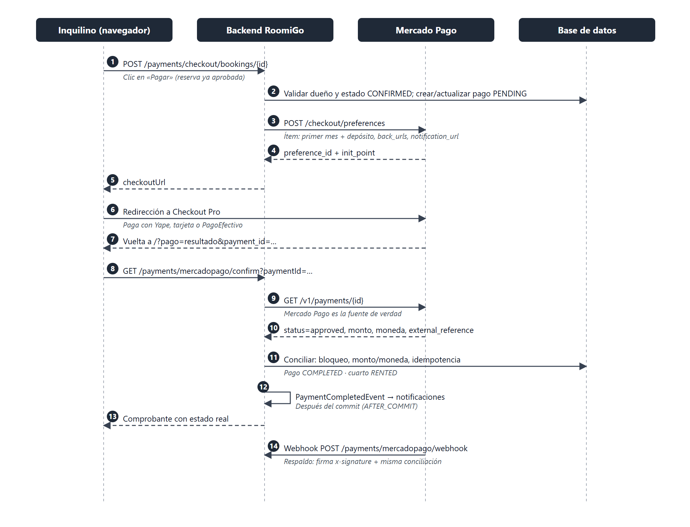

# Flujos de negocio

## 1. Reserva por meses

1. El inquilino elige la **fecha de inicio** y la **duración (1 a 12 meses)**. La fecha de fin se calcula:
   `endDate = startDate + months` (si el día no existe en el mes destino se usa el último, p. ej. 31-ene + 1 = 28-feb).
2. El backend valida que el cuarto esté disponible y que no haya otra reserva pendiente o confirmada que se solape.
3. Se guardan dos montos:
   - **Total del contrato** = renta mensual × meses + depósito.
   - **Pago inicial** = primer mes + depósito (lo que se cobra por Mercado Pago).
4. El propietario recibe una notificación y **aprueba o rechaza**. Aprobar no alquila el cuarto todavía:
   el cuarto pasa a *Alquilado* cuando se acredita el pago.

Estados de la reserva: `PENDING` → `CONFIRMED` (aprobada) o `REJECTED`; `CANCELLED` y `COMPLETED` existen para el
ciclo de vida completo.

## 2. Pago con Mercado Pago (Checkout Pro)

1. Con la reserva aprobada, el inquilino pulsa **Pagar**. El backend comprueba que sea el inquilino de esa reserva y
   que esté `CONFIRMED`, crea o reutiliza el registro de pago (`PENDING`) y pide a Mercado Pago una **preferencia**.
2. El usuario paga en la página de Mercado Pago (Yape, tarjetas o PagoEfectivo). RoomiGo no ve datos de tarjeta.
3. Mercado Pago lo devuelve a `/?pago=resultado&payment_id=…`. El frontend llama a
   `GET /payments/mercadopago/confirm` y el backend **consulta el pago a la API de Mercado Pago**.
4. `PaymentReconciler` aplica el resultado:
   - bloquea el registro (el webhook puede llegar a la vez),
   - exige que monto y moneda coincidan (si no, `FAILED` con detalle `monto_no_coincide`),
   - es idempotente y un pago `COMPLETED` no retrocede por un intento rechazado que llega tarde.
5. Si quedó `COMPLETED`: el cuarto pasa a `RENTED`, se publica `PaymentCompletedEvent` y se notifica a ambas partes.
6. El **webhook** es la vía de respaldo (PagoEfectivo se acredita después, o el usuario cierra la pestaña):
   valida la firma `x-signature` y usa la misma conciliación. Si Mercado Pago no responde, devuelve 502 para que
   reintente.

Mapeo de estados: `approved` → COMPLETED · `pending`/`in_process`/`authorized` → PENDING ·
`rejected`/`cancelled` → FAILED · `refunded`/`charged_back` → REFUNDED.

## 3. Publicación y moderación de un cuarto

1. El propietario registra su inmueble (propiedad) y publica cuartos con precio, depósito, tipo, servicios y fotos.
2. La publicación queda **`PENDING_APPROVAL`** hasta que el administrador la **aprueba** (`AVAILABLE`, visible en el
   catálogo) o la **rechaza** con un motivo (`REJECTED`). El propietario recibe una notificación en ambos casos.
3. El propietario paga la **tarifa de publicación** (S/ 15 por defecto) desde *Mis inmuebles* con el mismo flujo de
   Mercado Pago.

## 4. Notificaciones

| Evento | Destinatario | Tipo |
|---|---|---|
| Nueva solicitud de reserva | Propietario | `BOOKING_REQUEST` |
| Reserva aprobada (incluye el monto a pagar) | Inquilino | `BOOKING_APPROVED` |
| Reserva rechazada | Inquilino | `BOOKING_REJECTED` |
| Reserva cancelada | Propietario | `BOOKING_CANCELLED` |
| Pago inicial acreditado | Inquilino y propietario | `PAYMENT_CONFIRMED` / `PAYMENT_RECEIVED` |
| Tarifa de publicación pagada | Propietario | `PUBLICATION_PAID` |
| Cuarto aprobado o rechazado | Propietario | `ROOM_APPROVED` / `ROOM_REJECTED` |
| Nueva reseña | Propietario | `REVIEW_RECEIVED` |

La campana del navbar consulta el contador cada 45 s solo con la pestaña visible y **sin mostrar errores**: un
fallo de red se reintenta en el siguiente ciclo. Al hacer clic en un aviso se marca como leído y se abre la sección
correspondiente.
