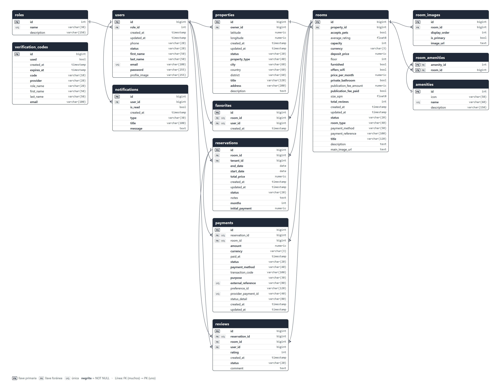

# Modelo de datos

> Generado desde la base PostgreSQL migrada con Flyway (V1–V4). Fuente de verdad del esquema:
> `api/src/main/resources/db/migration`. Hibernate solo **valida** (`ddl-auto=validate`).

## Resumen

- **13 tablas** del negocio, **121 columnas**, **16 llaves foráneas** y **10 restricciones CHECK**.
- Llaves primarias autoincrementales (`GENERATED BY DEFAULT AS IDENTITY`).
- Los enums de Java se guardan como texto y se protegen con restricciones `CHECK`.
- En Supabase todas las tablas tienen **Row Level Security** y se revocan los permisos de PostgREST:
  solo el backend accede a los datos (`supabase-rls-hardening.sql`).

## Migraciones

| Versión | Descripción | Cambios principales |
|---|---|---|
| V1 | Esquema inicial | Línea base de las 13 tablas (en Supabase se registra como *baseline* sin ejecutarse). |
| V2 | Reserva por meses | `reservations.months` (1–12). |
| V3 | Pagos Mercado Pago | `payments` genérica (`purpose`, `room_id`, `external_reference`, `preference_id`, `provider_payment_id`…) y `reservations.initial_payment`. |
| V4 | Índices de notificaciones | Índices para el contador de no leídas y la lista por fecha. |
| V5 | Publicaciones en venta y segmentación | `rooms.operation` (RENT/SALE), `sale_price`, `bedrooms`, `bathrooms`, `land_area_sqm`; renta y depósito opcionales (CHECK por operación); tipos `ROOM`/`MINI_APARTMENT`/`APARTMENT`/`HOUSE` (SINGLE y SHARED → ROOM, DOUBLE → MINI_APARTMENT, SUITE → APARTMENT); estado `SOLD`. |
| V6 | Categorías de fotos | `room_images.category` (FACADE, ROOM, BATHROOM, LIVING_KITCHEN, OTHER); las fotos existentes quedan como OTHER. |
| V7 | Pedidos de visita | Tabla `visit_requests`. |

## Tablas

### `amenities`

Catálogo de servicios (wifi, baño privado, etc.).

| Columna | Tipo | Nulo | Clave |
|---|---|---|---|
| `id` | integer | no | PK |
| `icon` | varchar(50) | sí |  |
| `name` | varchar(60) | no | UQ |
| `description` | varchar(150) | sí |  |

### `favorites`

Publicaciones guardadas por un usuario.

| Columna | Tipo | Nulo | Clave |
|---|---|---|---|
| `created_at` | timestamp | sí |  |
| `id` | bigint | no | PK |
| `room_id` | bigint | no | FK → `rooms.id`, UQ |
| `user_id` | bigint | no | FK → `users.id`, UQ |

### `notifications`

Avisos para el usuario (solicitudes, aprobaciones, pagos, reseñas, moderación).

| Columna | Tipo | Nulo | Clave |
|---|---|---|---|
| `is_read` | boolean | no |  |
| `created_at` | timestamp | sí |  |
| `id` | bigint | no | PK |
| `user_id` | bigint | no | FK → `users.id` |
| `type` | varchar(30) | no |  |
| `title` | varchar(100) | no |  |
| `message` | text | no |  |

### `payments`

Pagos por Mercado Pago: pago inicial de una reserva o tarifa de publicación de un cuarto.

| Columna | Tipo | Nulo | Clave |
|---|---|---|---|
| `amount` | numeric | no |  |
| `currency` | varchar(3) | no |  |
| `id` | bigint | no | PK |
| `paid_at` | timestamp | sí |  |
| `reservation_id` | bigint | sí | FK → `reservations.id`, UQ |
| `status` | varchar(20) | no |  |
| `payment_method` | varchar(40) | no |  |
| `transaction_code` | varchar(100) | sí |  |
| `purpose` | varchar(30) | no |  |
| `room_id` | bigint | sí | FK → `rooms.id`, UQ |
| `external_reference` | varchar(80) | no | UQ |
| `preference_id` | varchar(120) | sí |  |
| `provider_payment_id` | varchar(40) | sí | UQ |
| `status_detail` | varchar(80) | sí |  |
| `created_at` | timestamp | sí |  |
| `updated_at` | timestamp | sí |  |

Restricciones: `payments_purpose_check`, `payments_status_check`.

### `properties`

Inmueble (casa o edificio) de un propietario, con dirección y coordenadas.

| Columna | Tipo | Nulo | Clave |
|---|---|---|---|
| `latitude` | numeric | sí |  |
| `longitude` | numeric | sí |  |
| `created_at` | timestamp | sí |  |
| `id` | bigint | no | PK |
| `owner_id` | bigint | no | FK → `users.id` |
| `updated_at` | timestamp | sí |  |
| `status` | varchar(20) | no |  |
| `property_type` | varchar(40) | no |  |
| `city` | varchar(60) | no |  |
| `country` | varchar(60) | sí |  |
| `district` | varchar(60) | sí |  |
| `title` | varchar(120) | no |  |
| `address` | varchar(200) | no |  |
| `description` | text | sí |  |

Restricciones: `properties_property_type_check`.

### `reservations`

Solicitud/reserva de un inquilino por N meses: fechas, total del contrato y pago inicial.

| Columna | Tipo | Nulo | Clave |
|---|---|---|---|
| `end_date` | date | no |  |
| `start_date` | date | no |  |
| `total_price` | numeric | no |  |
| `created_at` | timestamp | sí |  |
| `id` | bigint | no | PK |
| `room_id` | bigint | no | FK → `rooms.id` |
| `tenant_id` | bigint | no | FK → `users.id` |
| `updated_at` | timestamp | sí |  |
| `status` | varchar(20) | no |  |
| `notes` | text | sí |  |
| `months` | integer | no |  |
| `initial_payment` | numeric | no |  |

Restricciones: `reservations_months_check`, `reservations_status_check`.

### `reviews`

Calificación (1–5) y comentario de un inquilino sobre una reserva.

| Columna | Tipo | Nulo | Clave |
|---|---|---|---|
| `rating` | integer | no |  |
| `created_at` | timestamp | sí |  |
| `id` | bigint | no | PK |
| `reservation_id` | bigint | no | FK → `reservations.id`, UQ |
| `room_id` | bigint | no | FK → `rooms.id` |
| `user_id` | bigint | no | FK → `users.id` |
| `status` | varchar(20) | no |  |
| `comment` | text | sí |  |

### `roles`

Roles del sistema: ROLE_ADMIN, ROLE_OWNER, ROLE_TENANT.

| Columna | Tipo | Nulo | Clave |
|---|---|---|---|
| `id` | integer | no | PK |
| `name` | varchar(30) | no | UQ |
| `description` | varchar(150) | sí |  |

Restricciones: `roles_name_check`.

### `room_amenities`

Relación muchos a muchos entre publicaciones y servicios.

| Columna | Tipo | Nulo | Clave |
|---|---|---|---|
| `amenity_id` | integer | no | PK, FK → `amenities.id` |
| `room_id` | bigint | no | PK, FK → `rooms.id` |

### `room_images`

Fotos de cada publicación, con orden y foto principal.

| Columna | Tipo | Nulo | Clave |
|---|---|---|---|
| `display_order` | integer | no |  |
| `is_primary` | boolean | no |  |
| `id` | bigint | no | PK |
| `room_id` | bigint | no | FK → `rooms.id` |
| `image_url` | text | no |  |
| `category` | varchar(20) | no |  |

### `rooms`

Publicación (cuarto, minidepartamento, departamento o casa entera) en alquiler o en venta, con sus precios y su
estado de moderación. En alquiler tiene `price_per_month` y `deposit_price`; en venta, `sale_price`.

| Columna | Tipo | Nulo | Clave |
|---|---|---|---|
| `accepts_pets` | boolean | no |  |
| `average_rating` | float8 | sí |  |
| `capacity` | integer | no |  |
| `currency` | varchar(3) | no |  |
| `deposit_price` | numeric | sí |  |
| `floor` | integer | sí |  |
| `furnished` | boolean | no |  |
| `offers_wifi` | boolean | no |  |
| `price_per_month` | numeric | sí |  |
| `operation` | varchar(10) | no |  |
| `sale_price` | numeric(12,2) | sí |  |
| `bedrooms` | integer | sí |  |
| `bathrooms` | integer | sí |  |
| `land_area_sqm` | float8 | sí |  |
| `private_bathroom` | boolean | no |  |
| `publication_fee_amount` | numeric | sí |  |
| `publication_fee_paid` | boolean | no |  |
| `size_sqm` | float8 | sí |  |
| `total_reviews` | integer | no |  |
| `created_at` | timestamp | sí |  |
| `id` | bigint | no | PK |
| `property_id` | bigint | no | FK → `properties.id` |
| `updated_at` | timestamp | sí |  |
| `status` | varchar(20) | no |  |
| `room_type` | varchar(40) | no |  |
| `payment_method` | varchar(50) | sí |  |
| `payment_reference` | varchar(100) | sí |  |
| `title` | varchar(120) | no |  |
| `description` | text | sí |  |
| `main_image_url` | text | sí |  |

Restricciones: `rooms_status_check`, `rooms_room_type_check`, `rooms_operation_check`,
`rooms_operation_prices_check` (precios según la operación), `rooms_counts_check`.

### `visit_requests`

Pedido de visita a una publicación en venta (reemplaza a la reserva en ventas).

| Columna | Tipo | Nulo | Clave |
|---|---|---|---|
| `id` | bigint | no | PK |
| `room_id` | bigint | no | FK → `rooms.id` (ON DELETE CASCADE) |
| `requester_id` | bigint | no | FK → `users.id` (ON DELETE CASCADE) |
| `preferred_date` | date | no |  |
| `preferred_time` | time | sí |  |
| `contact_phone` | varchar(20) | sí |  |
| `message` | text | sí |  |
| `status` | varchar(20) | no |  |
| `owner_note` | varchar(300) | sí |  |
| `created_at` | timestamp | sí |  |
| `updated_at` | timestamp | sí |  |

Restricciones: `visit_requests_status_check`.

### `users`

Cuentas de usuario (inquilinos, propietarios y administradores). Contraseña con BCrypt.

| Columna | Tipo | Nulo | Clave |
|---|---|---|---|
| `role_id` | integer | no | FK → `roles.id` |
| `created_at` | timestamp | sí |  |
| `id` | bigint | no | PK |
| `updated_at` | timestamp | sí |  |
| `phone` | varchar(20) | sí |  |
| `status` | varchar(20) | no |  |
| `first_name` | varchar(50) | no |  |
| `last_name` | varchar(50) | no |  |
| `email` | varchar(100) | no | UQ |
| `password` | varchar(255) | no |  |
| `profile_image` | varchar(255) | sí |  |

Restricciones: `users_status_check`.

### `verification_codes`

Códigos temporales para registro/acceso con Google o Facebook.

| Columna | Tipo | Nulo | Clave |
|---|---|---|---|
| `used` | boolean | no |  |
| `created_at` | timestamp | sí |  |
| `expires_at` | timestamp | no |  |
| `id` | bigint | no | PK |
| `code` | varchar(10) | no |  |
| `provider` | varchar(20) | no |  |
| `role_name` | varchar(20) | sí |  |
| `first_name` | varchar(50) | sí |  |
| `last_name` | varchar(50) | sí |  |
| `email` | varchar(100) | no |  |

## Valores de los enums

| Enum | Valores |
|---|---|
| Estado de la publicación (`rooms.status`) | PENDING_APPROVAL, AVAILABLE, RENTED, OCCUPIED, MAINTENANCE, REJECTED, SOLD |
| Tipo de inmueble (`rooms.room_type`) | ROOM (cuarto · estudiantes), MINI_APARTMENT (parejas), APARTMENT (familias), HOUSE (casa entera) |
| Operación (`rooms.operation`) | RENT, SALE |
| Categoría de foto (`room_images.category`) | FACADE, ROOM, BATHROOM, LIVING_KITCHEN, OTHER |
| Estado del pedido de visita | PENDING, CONFIRMED, DECLINED, CANCELLED |
| Estado de la reserva | PENDING, CONFIRMED, REJECTED, CANCELLED, COMPLETED |
| Estado del pago | PENDING, COMPLETED, FAILED, REFUNDED |
| Concepto del pago (`payments.purpose`) | BOOKING, ROOM_PUBLICATION |
| Tipo de notificación | BOOKING_REQUEST, BOOKING_APPROVED, BOOKING_REJECTED, BOOKING_CANCELLED, PAYMENT_CONFIRMED, PAYMENT_RECEIVED, PUBLICATION_PAID, ROOM_APPROVED, ROOM_REJECTED, REVIEW_RECEIVED, VISIT_REQUESTED, VISIT_CONFIRMED, VISIT_DECLINED, VISIT_CANCELLED |
| Rol | ROLE_ADMIN, ROLE_OWNER, ROLE_TENANT |
